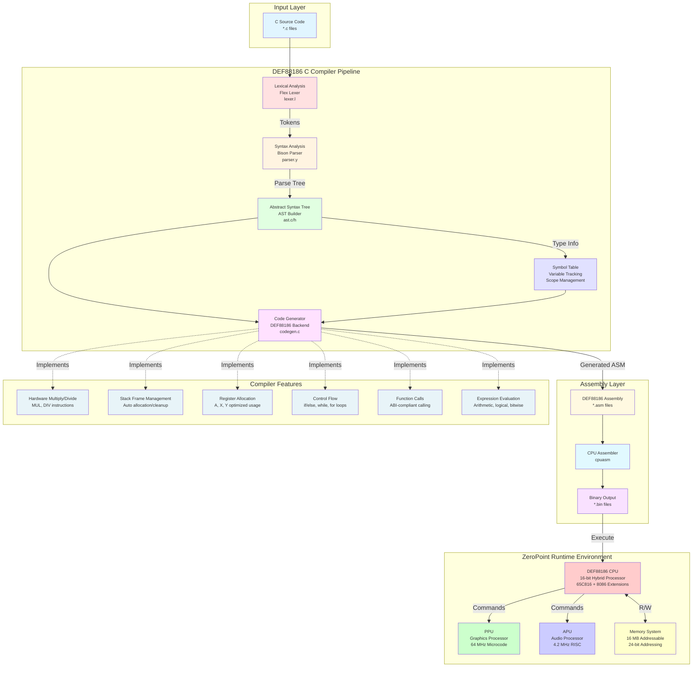
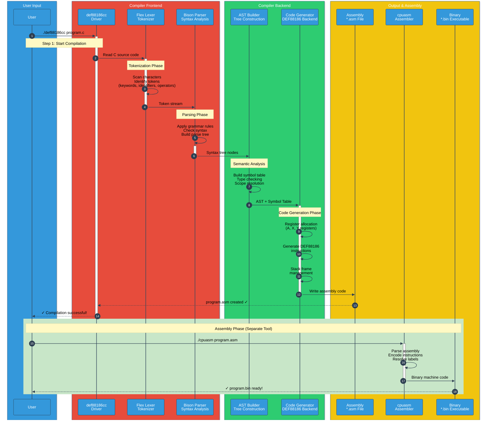

# DEF88186 C Compiler


A compiler for a subset of C89 that targets the DEF88186 hybrid CPU of the ZeroPoint Fantasy Console, small enough to run on a DOS machine. It refuses anything it cannot compile correctly; use `zpcc` (`../llvm_compiler/`) for full C.

## Overview

The compiler translates the subset described below into DEF88186 assembly. It is built with Flex and Bison: lexical analysis, parsing, an Abstract Syntax Tree, then code generation.

### Key Highlights

- **Full Compiler Pipeline**: Lexer → Parser → AST → Code Generator → Assembly Output
- **Hardware-Aware**: Leverages DEF88186's hardware multiply/divide instructions for performance
- **ABI Compliant**: Follows the DEF88186 calling conventions that `zpcc` shares
- **Stack Management**: Automatic stack frame allocation and cleanup

## What the compiler accepts today (read this first)

def88186cc is a small compiler for a **subset** of C89, small enough to run on a DOS machine. It makes two promises:

1. **Anything outside the subset is refused.** The compiler prints an error, exits non-zero and writes no output file.
   It never emits code for a construct it cannot compile correctly. (`zpcc`, the clang-based compiler, covers full C.)
2. **Anything it accepts behaves as C does.** This is checked by gcc-compared tests in the emulator (see *Testing*).

**Accepted**

- Types: `int`, `short` (16 bit), `long` (32 bit), `char` (8 bit), `signed`/`unsigned` forms, `void`, `struct` and `union`
  (members of any of these, pointers, arrays, nested structs), pointers to all of them.
- Local variables with initialisers, nested blocks with correct scoping, several declarators per declaration.
- **Arrays** (up to 4 dimensions, `a[i][j]`, `int a[] = {...}`), brace initialisers with elided/nested braces and zero fill,
  `char s[] = "text"`. **Pointers**: `&x`, `*p`, `p[i]`, `p->m`, `s.m`, `&a[i]`, `&s.m`, pointer arithmetic and comparison
  (`p + n`, `p - q`, `p++`, `p < q`), pointers to pointers, arrays of pointers, array/pointer parameters (`int a[]`), pointer
  results, `sizeof` of types, arrays and expressions.
- All C operators, including `++`/`--` and every `op=` on any lvalue (`a[i] += 2`, `*p++`, `s.n--`, `p->x <<= 1`).
- `if`/`else`, `while`, `do`/`while`, `for`, `break`, `continue`, `switch`/`case`/`default`, `goto` and labels, `return`.
- Functions: definitions, prototypes, `f(void)`, recursion, up to 16 parameters (`int`/`long`/`char`/pointers), pointer, `long`
  and narrow (`char`) arguments and results.
- Casts, decimal/octal/hex constants with `u`/`l` suffixes, character constants `'a'` `'\n'` `'\t'` `'\0'`, `__asm__("...")`.
- The preprocessor: `#include`, `#define` (object- and function-like), `#undef`, `#if`/`#ifdef`/`#ifndef`/`#elif`/`#else`/
  `#endif` with full constant expressions and `defined`, `#error`, `#line`, `#pragma` (ignored), `__LINE__`, `__FILE__`, `__STDC__`.

**How memory works.** A pointer is a 16-bit offset into bank $80, the bank that holds the stack and all data. `*p` compiles to
`TAX` / `LDA $800000,X` (and `STA` for stores), which does not depend on the data bank register. Local variables, arrays and
structs live in the stack frame, word aligned; a struct puts 16-bit members on even offsets and rounds its size up to a word.

**Refused with an error** (each is a real C89 feature this compiler does not implement)

- `float`, `double` and floating constants (the console has no FPU).
- **String literals as pointers**: ROM data is in another bank and cannot be reached through a bank-$80 pointer, so
  `char *s = "x"` and `f("x")` are errors. `char s[] = "x"` works (it copies the text into the array).
- Struct/union values: assignment `a = b`, passing or returning by value. Use pointers or copy member by member.
- `&array` (an array already is its address), pointer arithmetic on a multi-dimensional array (index it instead), `void *`
  dereference, `op=`/`++` on an lvalue with side effects in it (`a[i++] += 1`).
- Global variables, `static`, `extern` data, `const`/`volatile`/`register`, function pointers, bit-fields, K&R function
  definitions, `...` varargs, `typedef`, working `enum` constants, adjacent string-literal concatenation, `#` / `##` in macros,
  variadic macros.
- Character constants other than the four above (`'\x41'`, `'\\'`, `'\''` ...).

**Differences from ISO C inside the subset**

- Plain `char` is unsigned. `bool`, `true`, `false` and `_Bool` are keywords, so they cannot be identifiers.
- Integer promotions follow a 16-bit `int`: `char` of either signedness promotes to signed `int`; `unsigned short`/`unsigned`
  stay unsigned. A 32-bit host can disagree (see `t13_u16_semantics.c`).
- Pointer arithmetic wraps at 16 bits, and `p - q` is a 16-bit `int`.
- `//` comments are accepted. `__DATE__` and `__TIME__` are not defined (output is reproducible).
- Preprocessor limits, all reported as errors when hit: 30000 bytes per logical line or macro expansion, 64 levels of
  include/macro nesting, 5000 `#include`s per file, 256 nested `#if`s, 64 macro parameters. A macro call must fit on one
  logical line. Use a backslash to continue a line.
- **Stack frames** are limited to 255 bytes (locals, temporaries and stack arguments): `n,S` has a one-byte operand. A bigger
  function is an error; use smaller arrays or split it.
- **Hardware loops.** `for (i = 0; i < N; i = i + 1)` with a constant `N` of 1..32767 becomes the CPU's `LOOP`/`LPEND` pair, but only
  when it is the innermost loop, its body makes no calls, uses no `continue`/`goto`/inline asm, does not touch `i` and nothing
  in the function takes `&i`. The CPU has a single loop counter, so if an interrupt handler written in C contains such a loop
  and can interrupt another one, build the handler's file with `--no-hwloop`.

**Testing** (all under `tests/`)

| Command | What it checks |
|---|---|
| `tests/cc/run.sh dos` | hand-written programs run in the emulator and compared with gcc (`t01`-`t13`: calls, operators, long, loops, narrow types, arrays, pointers, structs, scoping and promotions) |
| `python3 tests/cc/fuzz_ops.py N SEED` | random programs (signed and unsigned arithmetic, control flow, calls) against a reference interpreter |
| `python3 tests/cc/fuzz_mem.py N SEED` | random programs over arrays, pointers (arithmetic, comparison, `&`), structs and pointer-taking helpers against a model that tracks every pointer's object |
| `python3 tests/cc/pp_tests.py` | the preprocessor, including every error path |
| `python3 tests/cc/reject_tests.py` | everything outside the subset is refused cleanly |
| `tests/cc/examples_check.sh` | `examples/*.c` compile; `examples/unsupported/*.c` are refused |
| `tests/c89/check.sh` | the compiler and tools are strict C89 (`gcc -std=c89 -pedantic`) |
| `tests/asm/check.sh` | `cpuasm` rejects operands that do not fit (`LDA 256,S`) and accepts `>label` long forms |
| `python3 tests/cc/zpcc_reject_tests.py` | the same for `zpcc`'s refusals (read-only globals, no global addresses as pointers) |

The two Python test scripts and the fuzzer also run against an AddressSanitizer/UBSan build (`gcc -fsanitize=address,undefined`);
see the header of `tests/cc/pp_tests.py`.

## System Architecture



## Compilation Flow



## Building

```bash
cd c_compiler
make
```

**Requirements:**
- GCC or Clang C compiler
- Flex (lexical analyzer generator)
- Bison (parser generator)
- Make build system

## Usage

```bash
# Compile C source to assembly
./def88186cc input.c -o output.asm

# Auto-generate output filename (input.asm)
./def88186cc input.c

# Assemble to binary
./cpuasm output.asm output.bin
```

## Examples

See `examples/` directory for sample programs:

**test1.c** - Function calls and recursion:
```c
int factorial(int n) {
    if (n <= 1) {
        return 1;
    }
    return n * factorial(n - 1);
}
```

**test2.c** - Control flow and loops:
```c
int sum_to_n(int n) {
    int sum = 0;
    int i = 1;
    while (i <= n) {
        sum = sum + i;
        i = i + 1;
    }
    return sum;
}
```

**test_sizeof.c** - sizeof operator:
```c
int main() {
    int size_int = sizeof(int);       // 2 bytes
    int size_char = sizeof(char);     // 1 byte
    int size_ptr = sizeof(int*);      // 2 bytes (pointer)
    return size_int + size_char + size_ptr;
}
```

**test_ternary.c** - Ternary operator:
```c
int max(int a, int b) {
    return (a > b) ? a : b;
}

int abs_value(int x) {
    return (x < 0) ? -x : x;
}
```

**test_switch.c** - Switch/case statements:
```c
int classify(int n) {
    int result;
    switch (n) {
        case 0:
            result = 100;
            break;
        case 1:
            result = 101;
            break;
        default:
            result = 999;
            break;
    }
    return result;
}
```

**test_multidim_arrays.c** - Multi-dimensional arrays:
```c
int main() {
    int matrix[3][4];  // 2D array: 12 elements
    int cube[2][3][4]; // 3D array: 24 elements
    return 0;
}
```

## Architecture Notes

The compiler follows the DEF88186 calling conventions (spelled out in `../docs/cpu/conventions.txt`):
- The first three argument words go in A, X and Y; the rest go on the stack
- Return value: A register
- 16-bit mode by default (REP #$30)
- Locals, arrays and structs live in the stack frame

### Code Generation Strategy

1. **Stack Frame Setup**: Automatically allocates space for local variables
2. **Register Allocation**:
   - A: Primary accumulator, return values, expression evaluation
   - X: Second parameter, temporary storage, array indexing
   - Y: Third parameter, secondary indexing
3. **Hardware Instructions**:
   - Uses DEF88186 `MUL` and `DIV` for efficient arithmetic
   - **LOOP/LPEND optimization**: Automatically detects simple counted loops and uses hardware loop instructions
4. **Label Management**: Generates unique labels for control flow structures

### Hardware Loop Optimization

The compiler intelligently detects simple counted loops and uses the DEF88186's hardware `LOOP`/`LPEND` instructions:

**Pattern Detected:**
```c
for (i = 0; i < N; i = i + 1)  // N must be constant
```

**Generated Code:**
```asm
LOOP #N          ; Hardware loop counter
    ; loop body
    i = i + 1    ; increment
LPEND            ; Auto-decrement and branch
```

**Benefits:**
- Faster execution (hardware-managed counter)
- Smaller code size (no manual labels/branches)
- More efficient than manual `CMP`/`BRA` loops

**Falls back to manual loops when:**
- Loop bound is not a constant
- Complex condition (e.g., `i < j` where both are variables)
- Non-unit increment (e.g., `i = i + 2`)

## Compiler Internals

| Component | File | Description |
|-----------|------|-------------|
| Lexer | `lexer.l` | Tokenizes C source code (Flex) |
| Parser | `parser.y` | Builds parse tree (Bison) |
| AST | `ast.h/c` | Abstract Syntax Tree implementation |
| Symbol Table | `codegen.c` | Variable and scope tracking |
| Code Generator | `codegen.c` | DEF88186 assembly emission |
| Driver | `main.c` | Compiler entry point |

## Limitations

See *What the compiler accepts today* at the top of this file: that section lists exactly what is accepted, what is refused
with an error, and where the compiler differs from ISO C.

## Performance Considerations

- **Hardware Multiply/Divide**: 8-13 cycles vs 100+ cycles for software implementation
- **Hardware Loops**: `LOOP`/`LPEND` instructions optimize simple counted loops
- **Register Parameters**: The first 3 parameter words avoid stack overhead
- **Compound Assignments**: Efficiently compiled using read-modify-write patterns
- **sizeof**: Compile-time constant evaluation (zero runtime cost)
- **Switch/case**: Linear comparison chain (O(n) - jump table optimization possible)
- **Tail Call Optimization**: Not yet implemented

## Contributing

Part of the ZeroPoint Fantasy Console project. Built with Claude Code.

## License

See main project LICENSE file.

---

**Built with [Claude Code](https://claude.com/claude-code)**

Co-Authored-By: Claude <noreply@anthropic.com>
